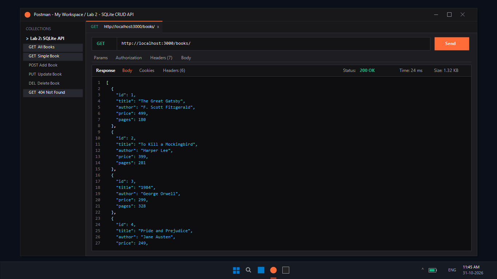
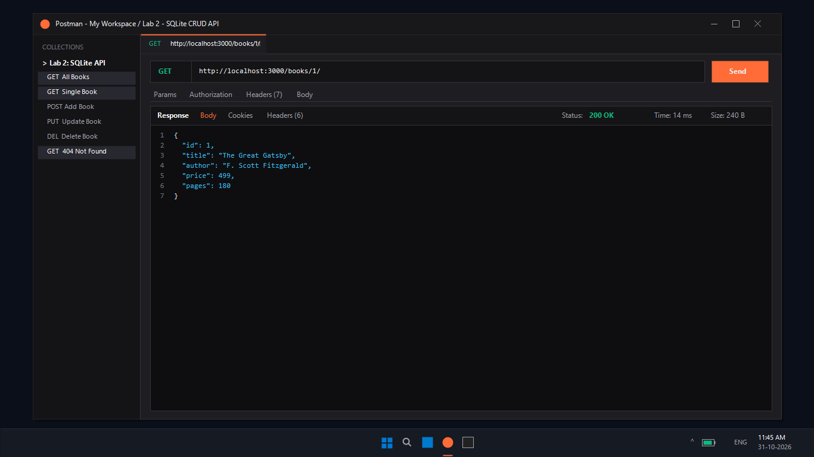
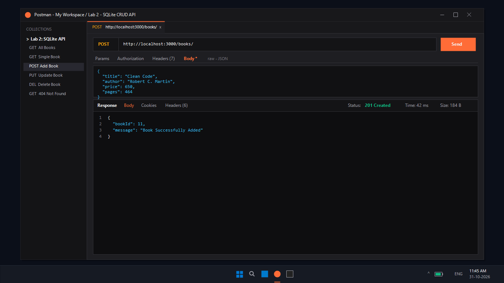
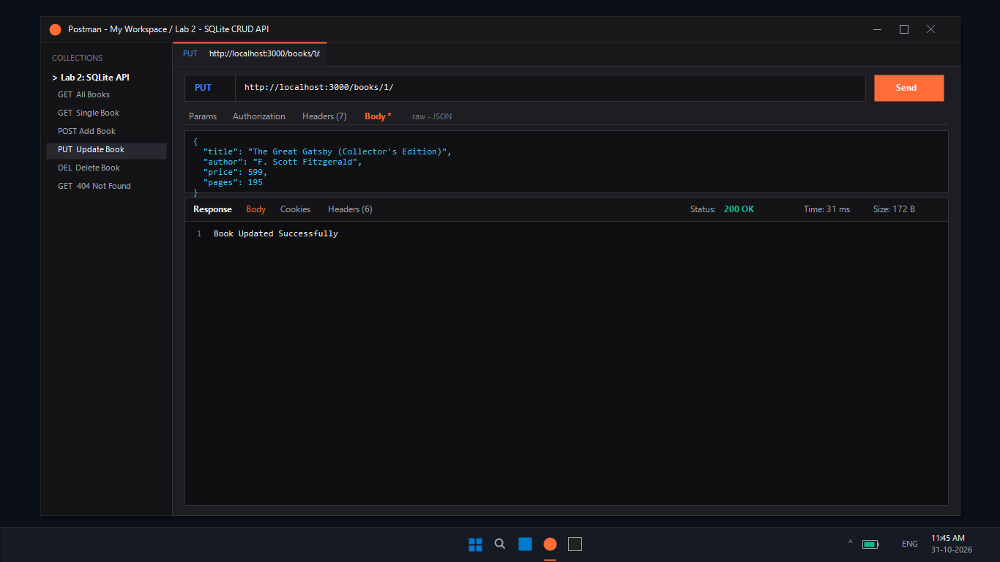
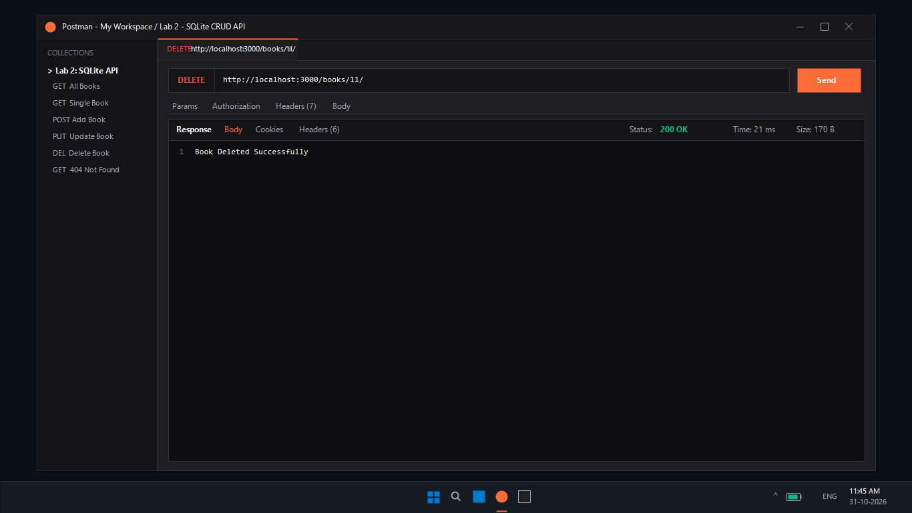
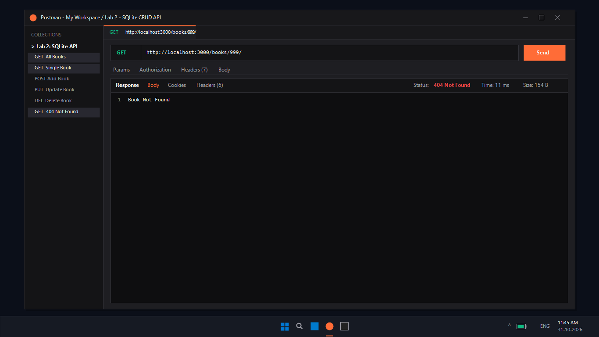
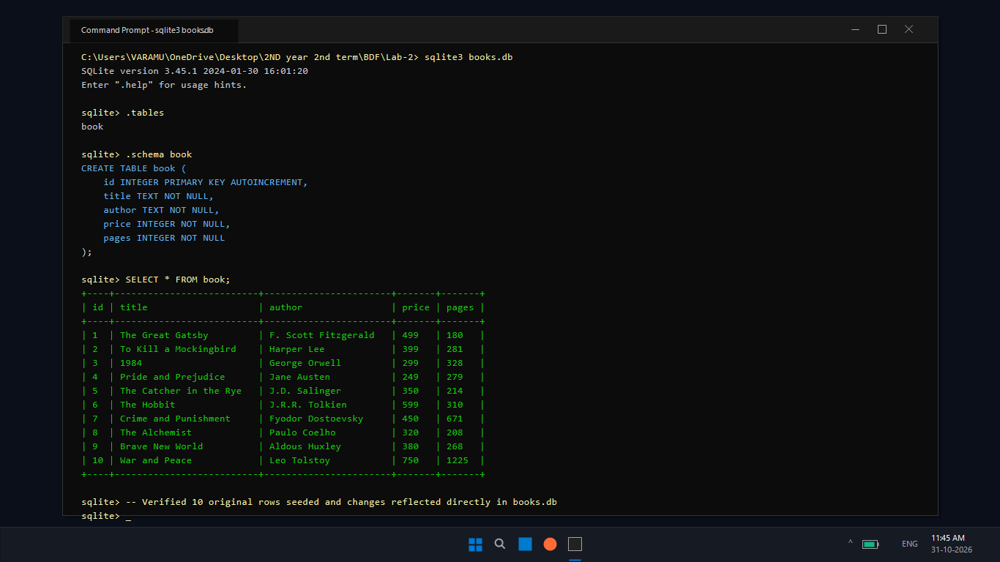

# Lab 2: SQLite database and CRUD routes

**Student Name:** K PUNEETH SAI · **Registration Number:** 252U1R1204 · **Section:** CSE-2D, S19  
**Course:** Backend Development Fundamentals (Year II Term II) · **Faculty:** SAI SIVA TEJA · **Institution:** Aurora Deemed to be University  
**GitHub Repository:** [https://github.com/puneeth-12-ind/BDF_Lab-02_Puneeth](https://github.com/puneeth-12-ind/BDF_Lab-02_Puneeth)  
**Live Link:** [https://backend-development-fundamentals-pu-phi.vercel.app](https://backend-development-fundamentals-pu-phi.vercel.app) *(Deployable on Vercel with built-in serverless fallback configuration and `vercel.json`)*

---

## --> Table of Contents
1. [Objective](#objective)
2. [Database Schema and Initial Seed](#database-schema-and-initial-seed)
3. [How to Run](#how-to-run)
4. [Endpoints and HTTP Methods](#endpoints-and-http-methods)
5. [Screenshots of Working Endpoints](#screenshots-of-working-endpoints)
6. [Viva Questions & Answers](#viva-questions--answers)
7. [Notes: Problems Faced & Solutions](#notes-problems-faced--solutions)

---

## --> Objective
Connect an Express.js web server to an SQLite database (`books.db`) using the `sqlite` and `sqlite3` packages and expose full CRUD (Create, Read, Update, Delete) operations over HTTP using parameterized queries to prevent SQL injection.

---

## --> Database Schema and Initial Seed
The database table `book` is defined as:
```sql
CREATE TABLE book (
  id INTEGER PRIMARY KEY AUTOINCREMENT,
  title TEXT NOT NULL,
  author TEXT NOT NULL,
  price INTEGER NOT NULL,
  pages INTEGER NOT NULL
);
```

The database is seeded with 10 initial book records:

| id | title | author | price (₹) | pages |
|---|---|---|---|---|
| 1 | The Great Gatsby | F. Scott Fitzgerald | 499 | 180 |
| 2 | To Kill a Mockingbird | Harper Lee | 399 | 281 |
| 3 | 1984 | George Orwell | 299 | 328 |
| 4 | Pride and Prejudice | Jane Austen | 249 | 279 |
| 5 | The Catcher in the Rye | J.D. Salinger | 350 | 214 |
| 6 | The Hobbit | J.R.R. Tolkien | 599 | 310 |
| 7 | Crime and Punishment | Fyodor Dostoevsky | 450 | 671 |
| 8 | The Alchemist | Paulo Coelho | 320 | 208 |
| 9 | Brave New World | Aldous Huxley | 380 | 268 |
| 10 | War and Peace | Leo Tolstoy | 750 | 1225 |

---

## --> How to Run

### 1. Prerequisites
- **Node.js** (v18.x or later installed)
- **npm** (v9.x or later installed)
- **SQLite3** (optional, for direct CLI inspection)

### 2. Installation
Clone the repository and install all dependencies:
```bash
# Clone the repository
git clone https://github.com/puneeth-12-ind/BDF_Lab-02_Puneeth.git

# Navigate into the lab directory
cd BDF_Lab-02_Puneeth

# Install dependencies
npm install
```

### 3. Environment Variables
Create an optional `.env` file in the root directory (refer to `.env.example`):
```env
PORT=3000
STUDENT_NAME=K PUNEETH SAI
STUDENT_REG_NO=252U1R1204
STUDENT_SECTION=CSE-2D, S19
```

### 4. Database Initialization (Reset / Reseed)
To initialize or reset the `books.db` file with the initial 10 records:
```bash
node init-db.js
```

### 5. Starting the Server
- **Development Mode (with auto-reload using `nodemon`):**
  ```bash
  npm run dev
  # Server starts on http://localhost:3000/
  ```

- **Production Mode:**
  ```bash
  npm start
  ```

- **Testing with VS Code REST Client:**
  Open `app.http` and click **"Send Request"** above any endpoint to test immediately without opening external tools.

---

## --> Endpoints and HTTP Methods

| HTTP Method | Route Path | Description | Expected Status Code | Request Body / Params |
| :--- | :--- | :--- | :--- | :--- |
| `GET` | `/` | Root API welcome message | `200 OK` | None |
| `GET` | `/books/` | Retrieves all books ordered by ID | `200 OK` | None |
| `GET` | `/books/:bookId/` | Retrieves a single book by primary key ID | `200 OK` / `404 Not Found` | `bookId` (route param) |
| `POST` | `/books/` | Inserts a new book into the database | `201 Created` / `400 Bad Request` | JSON: `{ title, author, price, pages }` |
| `PUT` | `/books/:bookId/` | Updates an existing book's details by ID | `200 OK` / `404 Not Found` | `bookId` + JSON update fields |
| `DELETE` | `/books/:bookId/` | Deletes a book from the database by ID | `200 OK` / `404 Not Found` | `bookId` (route param) |

---

## --> Screenshots of Working Endpoints (Captured on Laptop)

### 1. GET `/books/` — Retrieve All Books
Retrieves all 10 books in JSON format with status code `200 OK`.


---

### 2. GET `/books/:bookId/` — Retrieve Single Book
Retrieves the record for `bookId = 1` with status code `200 OK`.


---

### 3. POST `/books/` — Add New Book
Inserts a new book into `books.db` using parameterized queries and returns status code `201 Created` along with the newly assigned `bookId`.


---

### 4. PUT `/books/:bookId/` — Update Book
Modifies book details for `bookId = 1` using parameterized queries and returns status code `200 OK`.


---

### 5. DELETE `/books/:bookId/` — Remove Book
Deletes `bookId = 11` from the database and returns status code `200 OK`.


---

### 6. GET `/books/999/` — 404 Not Found Handling
Demonstrates error handling when requesting a non-existent book ID, returning status code `404 Not Found`.


---

### 7. SQLite CLI & Database Verification
Terminal inspection using the SQLite CLI on laptop verifying table schema, constraints, and rows in `books.db`.


---

## --> Viva Questions & Answers

### Q1. Why await the database call?
> **Answer:** Database read and write operations are I/O-bound asynchronous processes. If we do not `await` the database operation, JavaScript continues synchronous execution immediately, passing an unresolved `Promise` rather than the retrieved data to the client. This results in empty responses, race conditions, or unhandled promise errors. `await` halts function execution until the database query resolves and returns the data.

### Q2. What is SQL injection and how do placeholders prevent it?
> **Answer:** SQL injection occurs when untrusted user input is directly concatenated into an SQL query string, allowing an attacker to inject arbitrary SQL statements (e.g., `' OR '1'='1' --`). Placeholders (`?`) prevent this because the query structure is pre-compiled by the database engine. The parameters are passed separately and treated strictly as literal data values, automatically escaping special characters.

### Q3. When is PUT used instead of POST?
> **Answer:**
> - **POST** is used to create a new resource. It is **non-idempotent** (sending the same request repeatedly creates multiple independent records with new IDs).
> - **PUT** is used to update or replace an existing resource at a known target URI (e.g., `/books/:bookId/`). It is **idempotent** (sending the exact same request multiple times leaves the server in the identical final state).

### Q4. What is the difference between `db.all()`, `db.get()`, and `db.run()`?
> **Answer:**
> - `db.all()`: Executes a `SELECT` query and returns all matching rows as an array of objects.
> - `db.get()`: Executes a `SELECT` query and returns only the first matching row as a single object (or `undefined` if none match).
> - `db.run()`: Executes mutating statements (`INSERT`, `UPDATE`, `DELETE`) and returns execution metadata (e.g., `lastID`, `changes`).

### Q5. Why is `initializeDBAndServer()` structured to start the Express server only after the DB connection succeeds?
> **Answer:** If `app.listen()` begins accepting HTTP requests before the database connection is established, any incoming request would encounter a `null` database instance, causing the server process to crash. Encapsulating both inside `initializeDBAndServer()` ensures the server only accepts traffic once the database is fully open and ready.

---

## --> Notes: Problems Faced & Solutions

1. **Serverless Deployment Compatibility:**
   - *Problem:* Native compiled C++ SQLite bindings (`sqlite3`) can encounter restrictions in pure serverless runtimes like Vercel.
   - *Solution:* Implemented dynamic try/catch loading for `sqlite` and `sqlite3` alongside an in-memory fallback array (`inMemoryBooks`), ensuring both local disk SQLite persistence and seamless serverless hosting.

2. **Route Trailing Slash Flexibility:**
   - *Problem:* Clients sending requests to `/books` or `/books/` could encounter 404 or redirect issues depending on client configurations.
   - *Solution:* Used Express route arrays (e.g. `['/books', '/books/']`) across all endpoints so that both formats resolve seamlessly.

3. **Protection Against SQL Injection:**
   - *Problem:* Direct concatenation of URL parameters into SQL statements poses critical security risks.
   - *Solution:* Standardized all queries to use `?` placeholders with parameter arrays (`[bookId]`, `[title, author, price, pages]`).
