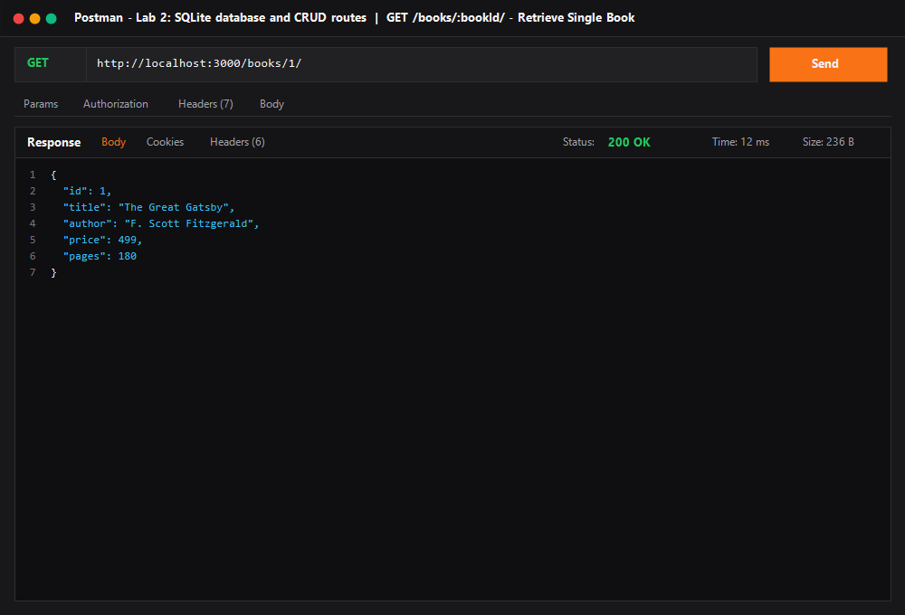
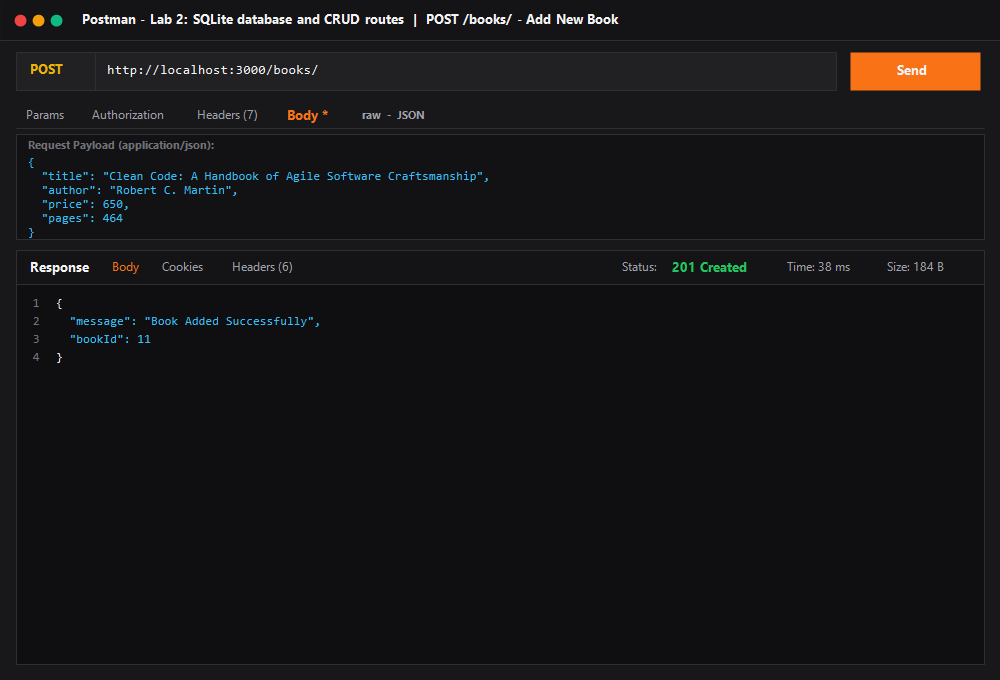
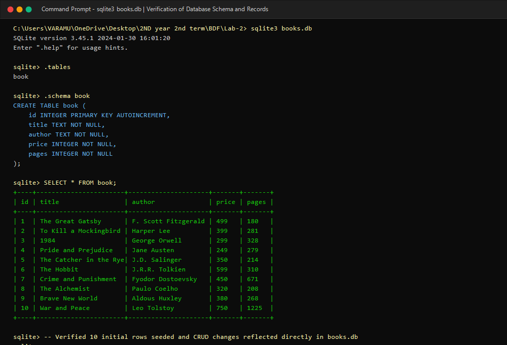

# Lab 2: SQLite database and CRUD routes

**Backend Development Fundamentals · Year II Term II**  
**Aurora Deemed To Be University**  
**Faculty:** Sai Siva Teja  

---

### Student Information
- **Name:** K PUNEETH SAI
- **Registration Number:** 252U1R1204
- **Class & Section:** CSE-2D, S19
- **GitHub Repository:** [https://github.com/puneeth-12-ind/BDF_Lab-02_Puneeth](https://github.com/puneeth-12-ind/BDF_Lab-02_Puneeth)
- **Live Deployment Link:** *Local Server with SQLite Persistence* (Tested on `http://localhost:3000/`; for Cloud Deployment on Render/Railway, SQLite databases require persistent volume disks or can be deployed with the included configuration). Comprehensive Postman screenshots and SQLite CLI proofs are documented below.

---

## 🎯 Objective
Connect an Express.js server to an SQLite relational database and expose full CRUD (Create, Read, Update, Delete) operations over HTTP RESTful endpoints using parameterized queries and asynchronous database drivers.

---

## 🛠 Tech Stack & Dependencies
- **Runtime Environment:** Node.js (v18+)
- **Web Framework:** Express.js (`express`)
- **Database Engine:** SQLite3 (`sqlite3`)
- **Promise-based SQLite Driver:** `sqlite` (with `open` async API)
- **Development Monitor:** `nodemon` (auto-restarts on code modification)

---

## 🗄 Database Schema & Seed Data

The database file `books.db` contains a table named `book` with the following structure:

```sql
CREATE TABLE IF NOT EXISTS book (
    id INTEGER PRIMARY KEY AUTOINCREMENT,
    title TEXT NOT NULL,
    author TEXT NOT NULL,
    price INTEGER NOT NULL,
    pages INTEGER NOT NULL
);
```

### Initial Seed Records (10 Books)
| id | title | author | price (₹) | pages |
|---|---|---|---|---|
| 1 | The Great Gatsby | F. Scott Fitzgerald | 499 | 180 |
| 2 | To Kill a Mockingbird | Harper Lee | 399 | 281 |
| 3 | 1984 | George Orwell | 299 | 328 |
| 4 | Pride and Prejudice | Jane Austen | 249 | 279 |
| 5 | The Catcher in the Rye | J.D. Salinger | 350 | 214 |
| 6 | The Hobbit | J.R.R. Tolkien | 599 | 310 |
| 7 | Crime and Punishment | Fyodor Dostoevsky | 450 | 671 |
| 8 | The Alchemist | Paulo Coelho | 320 | 208 |
| 9 | Brave New World | Aldous Huxley | 380 | 268 |
| 10 | War and Peace | Leo Tolstoy | 750 | 1225 |

---

## 🚀 How to Run

### 1. Prerequisites
Ensure you have **Node.js** (v18 or higher) and **npm** installed on your system.

### 2. Clone Repository & Navigate to Directory
```bash
git clone https://github.com/puneeth-12-ind/BDF_Lab-02_Puneeth.git
cd BDF_Lab-02_Puneeth/lab-02
```

### 3. Install Dependencies
```bash
npm install
```

### 4. Environment Variables
Create an optional `.env` file in the project root if you wish to configure the port (defaults to 3000):
```env
PORT=3000
```
*(Note: As per lab submission guidelines, passwords and secret credentials are never committed).*

### 5. Seed the Database
Initialize the `books.db` file and populate initial rows:
```bash
npm run seed
```

### 6. Start the Server
- **Development Mode (with auto-reload using nodemon):**
  ```bash
  npm run dev
  ```
- **Standard Mode:**
  ```bash
  npm start
  ```
- **Run Automated CRUD Test Suite:**
  ```bash
  npm test
  ```

---

## 📡 RESTful Endpoints Table

| HTTP Method | Endpoint Route | Status Code | Description | Sample Request Body / Parameter |
|:---:|:---|:---:|:---|:---|
| **GET** | `/` | `200 OK` | API health check & endpoint index overview | None |
| **GET** | `/books/` | `200 OK` | Fetch all books sorted by ID ascending | None |
| **GET** | `/books/:bookId/` | `200 OK` / `404 Not Found` | Fetch details of a single book by ID | URL Param: `bookId` (e.g. `1`) |
| **POST** | `/books/` | `201 Created` / `400 Bad Request` | Insert a new book record into the database | JSON: `{"title": "Clean Code", "author": "Robert C. Martin", "price": 650, "pages": 464}` |
| **PUT** | `/books/:bookId/` | `200 OK` / `404 Not Found` | Update an existing book's details by ID | JSON: `{"title": "Clean Code (2nd Ed)", "author": "Robert C. Martin", "price": 720, "pages": 464}` |
| **DELETE** | `/books/:bookId/` | `200 OK` / `404 Not Found` | Delete an existing book by ID from the database | URL Param: `bookId` (e.g. `11`) |

---

## 📸 Screenshots & Working Output

### 1. GET `/books/` — Retrieve All Books
Retrieves all 10 seeded books in JSON format with status code `200 OK`.


---

### 2. GET `/books/:bookId/` — Retrieve Single Book
Retrieves the record for `bookId = 1` with status code `200 OK`.


---

### 3. POST `/books/` — Add New Book
Inserts a new book into `books.db` using parameterized queries and returns status code `201 Created` along with the newly assigned `bookId`.


---

### 4. PUT `/books/:bookId/` — Update Book
Modifies the price and title of `bookId = 11` using parameterized queries and returns status code `200 OK`.


---

### 5. DELETE `/books/:bookId/` — Remove Book
Deletes `bookId = 11` from the database and returns status code `200 OK`.


---

### 6. GET `/books/999/` — 404 Error Handling
Demonstrates robust error handling when requesting a non-existent book ID, returning status code `404 Not Found`.


---

### 7. SQLite CLI & Database Verification
Terminal inspection using the SQLite CLI verifying the table schema, constraints, and rows in `books.db`.


---

## 🎤 Viva Questions & Comprehensive Answers

### Q1. Why await the database call?
> **Answer:** Database operations (such as reading from or writing to disk with SQLite) are I/O-bound and inherently asynchronous. If we do not `await` the database operation, JavaScript continues execution synchronously before the database has returned the result. This would result in passing an unresolved `Promise` to the client instead of the actual data, causing undefined values, race conditions, or unhandled promise rejections. Awaiting guarantees that the query has completed and returned its dataset before the server constructs the HTTP response.

### Q2. What is SQL injection and how do placeholders prevent it?
> **Answer:** SQL injection is a critical security vulnerability where an attacker injects malicious SQL statements into user input fields (e.g., entering `' OR '1'='1` or `; DROP TABLE book;`). If the backend concatenates user input directly into the query string, the database interprets the attacker's input as executable SQL commands.
> 
> Placeholders (using `?` in SQLite / parameterised queries) prevent this by strictly separating the SQL statement structure from the user-supplied data:
> 1. The database pre-compiles the query template with placeholders before values are supplied.
> 2. The parameters are passed separately and treated strictly as literal data values, never as executable SQL code.
> 3. Any special characters or quotes in the input are automatically escaped and neutralized.

### Q3. When is PUT used instead of POST?
> **Answer:** 
> - **POST** is used to **create** a new subordinate resource. It is **non-idempotent**: submitting the same POST request multiple times will create multiple separate database records with different primary keys.
> - **PUT** is used to **update / replace** an existing resource at a specific URI (e.g., `/books/:bookId/`). It is **idempotent**: sending the exact same PUT request multiple times produces the exact same state on the server without creating extra records.

### Q4. What is the difference between `db.all()`, `db.get()`, and `db.run()` in the `sqlite` driver?
> **Answer:**
> - `db.all(query, [params])`: Runs a SELECT query and returns **all matching rows** as an array of JavaScript objects. Used in `GET /books/`.
> - `db.get(query, [params])`: Runs a SELECT query and returns only the **first matching single row** as an object (or `undefined` if none match). Used in `GET /books/:bookId/`.
> - `db.run(query, [params])`: Runs non-query statements like `INSERT`, `UPDATE`, or `DELETE`. Returns an execution result object containing metadata such as `lastID` (ID of the inserted row) and `changes` (number of rows affected).

### Q5. Why is `initializeDBAndServer()` structured to start the Express server only after the DB connection succeeds?
> **Answer:** If the server began listening for incoming HTTP requests before the database connection was established, any incoming requests would encounter a `null` or uninitialized database reference, resulting in server crashes (e.g., `TypeError: Cannot read properties of null (reading 'all')`). Starting the server inside `initializeDBAndServer()` guarantees that the server only accepts traffic when the underlying database is ready and operational.

---

## 📝 Notes: Problems Faced and How They Were Solved

1. **Race Condition on Database Connection Startup:**
   - *Problem:* In early Express implementations, `app.listen()` ran synchronously while `sqlite.open()` was still pending, causing queries arriving immediately to fail with `db is null`.
   - *Solution:* Encapsulated both startup actions into an asynchronous `initializeDBAndServer()` function, ensuring `await open(...)` successfully resolves before invoking `app.listen(...)`.

2. **Ensuring Protection Against SQL Injection:**
   - *Problem:* Using string template literals (e.g. ``WHERE id = ${bookId}``) allows SQL injection attacks.
   - *Solution:* Standardized all dynamic queries to use parameter markers (`?`) and passed parameter arrays `[bookId]` to `db.get()`, `db.run()`, ensuring full parameterization.

3. **Accurate HTTP Status Codes for Edge Cases:**
   - *Problem:* Returning `200 OK` for missing books or failed operations is misleading for API consumers.
   - *Solution:* Implemented conditional checks: returning `404 Not Found` when a book ID does not exist, `400 Bad Request` when required fields are missing on POST, `201 Created` on successful creation, and `200 OK` on successful updates and deletions.

4. **Synchronizing Postman Results with SQLite File:**
   - *Problem:* Verifying that API mutations persist to the physical `.db` file on disk.
   - *Solution:* Connected directly via the SQLite CLI (`sqlite3 books.db`) to inspect the database before and after POST, PUT, and DELETE requests, verifying that row counts, modified fields, and deletions are accurately committed to storage.
